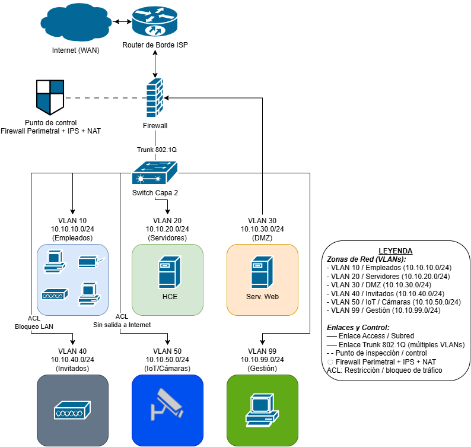

# Diseño de Red Segura para PyME — Clínica Dental "Sonrisa Integral"

Proyecto práctico correspondiente al **Módulo 6**, enfocado en el diseño lógico, segmentación mediante VLANs, control de acceso perimetral e interno (ACLs/Firewall) y validación funcional en entorno simulado.

---

## 1. Escenario y Activos Críticos (Fase 0)

* **Organización ficticia:** Clínica Dental "Sonrisa Integral" (sede única, 25 empleados entre odontólogos, recepcionistas, personal administrativo y soporte externo).
* **Infraestructura tecnológica:**
  * 15 estaciones de trabajo (recepción, consultorios y administración).
  * 1 servidor interno de archivos e historias clínicas electrónicas (HCE).
  * 1 servidor web público (portal informativo y reserva de citas online).
  * 3 impresoras de red multifunción.
  * 1 Access Point empresarial con doble SSID (Corporativo e Invitados).
  * 6 cámaras de videovigilancia IP (pasillos, recepción y acceso principal).

### Inventario de Activos y Análisis de Impacto

| Activo | Descripción | Nivel de Criticidad | Impacto si se compromete o pierde |
| :--- | :--- | :---: | :--- |
| **Base de Datos y Servidor HCE** | Historias clínicas, radiografías y datos personales de pacientes. | **Crítico** | Sanciones legales por fuga de datos sensibles, pérdida de confianza y paralización operativa. |
| **Servidor Web Público** | Sitio web de la clínica y formulario de citas. | **Alto** | Suplantación de identidad (defacement), caída del canal de captación o punto de pivote hacia la red interna. |
| **Estaciones de Recepción/Admin** | Equipos que gestionan facturación, pagos y agendas. | **Alto** | Fraude financiero, robo de credenciales o infección por ransomware. |
| **Cámaras IP (IoT)** | Sistema de monitoreo físico 24/7. | **Medio** | Espionaje físico o uso de los dispositivos como botnet dentro de la red. |
| **Red Wi-Fi de Invitados** | Acceso a Internet para pacientes en sala de espera. | **Bajo** | No contiene activos propios, pero representa una frontera de entrada no confiable. |

---

## 2. Modelo de Amenazas (Fase 1)

| ID | Amenaza | Vector de Ataque | Activo Afectado | Control de Red Mitigante |
| :--- | :--- | :--- | :--- | :--- |
| **AM-01** | **Movimiento lateral desde Wi-Fi de Invitados** | Un paciente malicioso conectado al Wi-Fi público escanea la red e intenta acceder al servidor HCE o impresoras. | Servidor HCE, LAN Empleados | Aislamiento total de VLAN Invitados (`VLAN 40`), bloqueo de tráfico RFC1918 (redes privadas) en el firewall y *Client Isolation* en el AP. |
| **AM-02** | **Compromiso del Servidor Web expuesto** | Explotación de una vulnerabilidad web (ej. SQLi/RCE) para saltar desde el servidor web hacia la red interna. | Servidor Web, Servidor HCE | Ubicación del servidor en una **DMZ** (`VLAN 30`) con bloqueo estricto de conexiones salientes iniciadas desde DMZ hacia LAN o Servidores. |
| **AM-03** | **Propagación de Ransomware / Malware** | Un empleado abre un adjunto malicioso por correo y el malware intenta cifrar toda la red y cámaras. | LAN Empleados, Servidor HCE, IoT | Segmentación por zonas, firewall inter-VLAN permitiendo solo puertos específicos (SMB/HTTPS) y bloqueo de administración desde la LAN de usuarios. |
| **AM-04** | **Secuestro de Cámaras IP (IoT)** | Firmware desactualizado o credenciales débiles en cámaras IP utilizadas para pivotar a equipos internos. | Cámaras IP, Red Interna | Reclusión en `VLAN 50` (IoT) sin acceso a Internet saliente directo y sin permisos para iniciar tráfico hacia otras VLANs. |
| **AM-05** | **Acceso no autorizado a Gestión de Red** | Un usuario interno o atacante intenta acceder por SSH/Web a la consola del firewall, switches o AP. | Equipos de Red | Creación de una `VLAN 99` (Gestión) dedicada, accesible únicamente desde la estación de administración de TI mediante SSH/HTTPS. |

---

## 3. Diagrama de Arquitectura Lógica y Física (Fase 3)

> *El archivo fuente editable se encuentra disponible en [`diagramas/arquitectura-red-segura.drawio`](diagramas/arquitectura-red-segura.drawio).*

---

## 4. Plan de Direccionamiento y Matriz de Comunicación (Fase 2)

### Plan de Direccionamiento IP (Esquema `10.10.X.0/24`)

| VLAN | Nombre de Zona | Subred | Gateway | Rango DHCP / Estático | Propósito |
| :---: | :--- | :--- | :--- | :--- | :--- |
| **10** | `LAN_EMPLEADOS` | `10.10.10.0/24` | `10.10.10.1` | `.50 - .150` (DHCP) / `.10 - .20` (Impresoras) | PCs de consultorios, recepción, administración e impresoras. |
| **20** | `SERVIDORES` | `10.10.20.0/24` | `10.10.20.1` | `.10 - .30` (Estático) | Servidor de archivos e Historias Clínicas (HCE) y respaldos. |
| **30** | `DMZ` | `10.10.30.0/24` | `10.10.30.1` | `.10` (Estático) | Servidor Web público expuesto a Internet mediante NAT/PAT. |
| **40** | `INVITADOS` | `10.10.40.0/24` | `10.10.40.1` | `.20 - .200` (DHCP) | Wi-Fi para pacientes en sala de espera (solo salida a Internet). |
| **50** | `IOT_CAMARAS` | `10.10.50.0/24` | `10.10.50.1` | `.10 - .30` (Estático) | Cámaras IP y NVR de videovigilancia interna. |
| **99** | `GESTION` | `10.10.99.0/24` | `10.10.99.1` | `.10 - .20` (Estático) | Interfaces de administración (SSH/HTTPS) de Firewall, Switch y AP. |

### Matriz de Comunicación Inter-Zonas

*Política base: **Denegación por defecto (Implicit Deny)** entre todas las zonas.*

| Origen \ Destino | VLAN 10 (Empleados) | VLAN 20 (Servidores) | VLAN 30 (DMZ) | VLAN 40 (Invitados) | VLAN 50 (IoT) | VLAN 99 (Gestión) | WAN (Internet) |
| :--- | :---: | :---: | :---: | :---: | :---: | :---: | :---: |
| **VLAN 10 (Empleados)** | Permitido | **Restringido** (HCE) | **Restringido** (Web) | Bloqueado | **Restringido** (Ver NVR) | Bloqueado | **Permitido** (HTTP/S, DNS) |
| **VLAN 20 (Servidores)** | Bloqueado (solo respuesta) | Permitido | Bloqueado | Bloqueado | Bloqueado | Bloqueado | **Restringido** (Updates) |
| **VLAN 30 (DMZ)** | **BLOQUEADO** | **BLOQUEADO** | Permitido | **BLOQUEADO** | **BLOQUEADO** | **BLOQUEADO** | **Restringido** (Updates) |
| **VLAN 40 (Invitados)** | **BLOQUEADO** | **BLOQUEADO** | **Restringido** (Web pública) | Aislado | **BLOQUEADO** | **BLOQUEADO** | **Permitido** (HTTP/S, DNS) |
| **VLAN 50 (IoT)** | **BLOQUEADO** | **BLOQUEADO** | **BLOQUEADO** | **BLOQUEADO** | Permitido (NVR) | **BLOQUEADO** | **BLOQUEADO** |
| **VLAN 99 (Gestión)** | **Permitido** | **Permitido** | **Permitido** | **Permitido** | **Permitido** | Permitido | **Restringido** (NTP/Updates) |
| **WAN (Internet)** | **BLOQUEADO** | **BLOQUEADO** | **Permitido** (TCP 80/443) | **BLOQUEADO** | **BLOQUEADO** | **BLOQUEADO** | — |

---

## 5. Reglas de Firewall de Ejemplo (Fase 4)

| Orden | Origen | Destino | Protocolo / Puerto | Acción | Amenaza Mitigada / Motivo |
| :---: | :--- | :--- | :--- | :---: | :--- |
| **1** | `WAN (Any)` | `10.10.30.10` (Web DMZ) | TCP `80, 443` | **ALLOW** | Publicación del portal de citas médicas hacia Internet (vía DNAT). |
| **2** | `10.10.30.0/24` (DMZ) | `10.10.0.0/16` (Red Interna) | `ANY` | **DENY** | **AM-02:** Impide que un servidor web comprometido pivote hacia la red interna. |
| **3** | `10.10.40.0/24` (Invitados) | `10.10.0.0/16` (Red Interna) | `ANY` | **DENY** | **AM-01:** Aísla completamente a los visitantes de cualquier recurso interno. |
| **4** | `10.10.40.0/24` (Invitados) | `WAN (Any)` | TCP `80, 443`, UDP `53` | **ALLOW** | Permite navegación web básica y resolución DNS a pacientes. |
| **5** | `10.10.10.0/24` (Empleados) | `10.10.20.10` (Servidor HCE) | TCP `443, 445` | **ALLOW** | **AM-03:** Acceso exclusivo a la aplicación clínica y carpetas compartidas autorizadas. |
| **6** | `10.10.50.0/24` (IoT) | `ANY` (Incluye WAN) | `ANY` | **DENY** | **AM-04:** Evita que cámaras IP envíen datos al exterior o ataquen la LAN. |
| **7** | `10.10.99.10` (PC Admin TI) | `10.10.99.0/24` (Gestión) | TCP `22, 443` | **ALLOW** | **AM-05:** Administración segura de equipos de infraestructura. |
| **8** | `ANY` | `ANY` | `ANY` | **DENY** | **Política de denegación por defecto (Implicit Deny).** |

---

## 6. Validación en Cisco Packet Tracer (Fase 5)

Se implementó una topología reducida con arquitectura *Router-on-a-Stick* (`1 Router`, `1 Switch Capa 2`, `3 VLANs: 10, 20 y 40`) y listas de control de acceso extendidas (ACLs) para comprobar el aislamiento de la red de invitados.

* **Archivo de laboratorio:** [`packet-tracer/lab-red-segura.pkt`](packet-tracer/lab-red-segura.pkt)
* **Pruebas verificadas:**
  1. `PC-Empleado (10.10.10.50)` $\rightarrow$ `Servidor-HCE (10.10.20.10)`: **Exitoso (Reply)**.
  2. `PC-Invitado (10.10.40.20)` $\rightarrow$ `Servidor-HCE (10.10.20.10)`: **Bloqueado (Destination host unreachable / Administratively prohibited)**.

---

## 7. Limitaciones y Mejoras Futuras (Fase 4)

* **Sin redundancia física (Punto único de fallo):** El diseño contempla un único firewall y un único switch principal por restricciones de presupuesto PyME. *Mejora futura:* Implementar alta disponibilidad (HA Active/Passive) y enlaces troncales redundantes (EtherChannel).
* **Factores humanos (Ingeniería social):** Las reglas de firewall no detienen a un empleado que entregue sus credenciales en un sitio de phishing. *Mejora futura:* Habilitar autenticación multifactor (MFA) y capacitación periódica.
* **Tráfico cifrado (HTTPS):** Sin inspección SSL/TLS profunda (DPI), un malware oculto dentro de tráfico cifrado hacia Internet podría pasar inadvertido. *Mejora futura:* Implementar un proxy web con filtrado de categorías DNS/URL.

---

## 8. Relación con el Módulo 6

Este proyecto aplica directamente los conceptos desarrollados en el curso **Dispositivos de Red y Configuración Inicial**:
* Diseño jerárquico y segmentación lógica mediante **VLANs (IEEE 802.1Q)** y enlaces troncales (*Trunking*).
* Enrutamiento inter-VLAN (*Router-on-a-Stick*) y asignación dinámica/estática de direccionamiento IPv4.
* Endurecimiento (*Hardening*) de dispositivos de red, segregación de planos de gestión y aplicación del principio de mínimo privilegio mediante **ACLs extendidas**.
