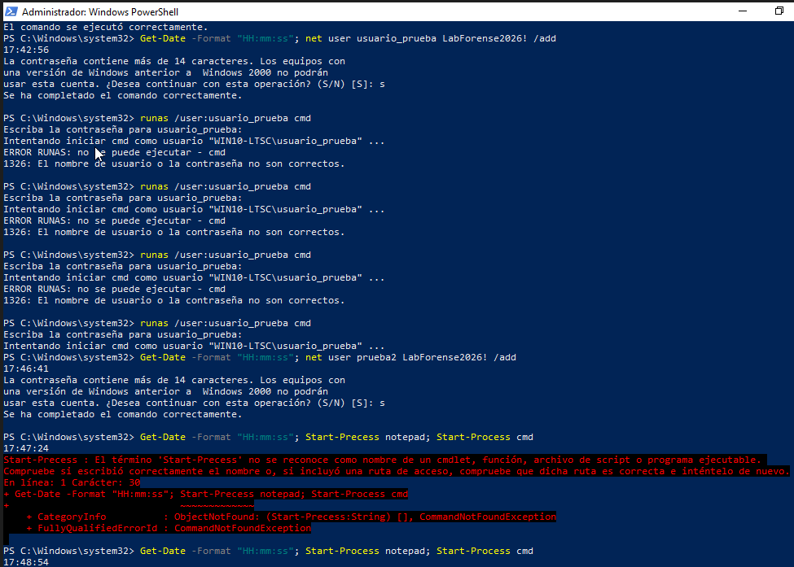
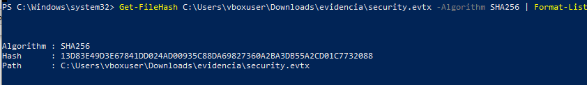

## Revisión de logs de eventos de seguridad en Windows

Proyecto práctico del **Módulo 9: Protección de terminales**, curso *Seguridad de Terminales* (Cisco Networking Academy).

Simulo actividad de autenticación en un equipo Windows aislado, la localizo en el registro de Seguridad, preservo el log como evidencia (hash SHA-256 y cadena de custodia) y reconstruyo la línea de tiempo, como en una investigación forense básica.

---

## Objetivo

- Activar la auditoría de seguridad de Windows y verificar que registra los eventos relevantes.
- Generar eventos controlados (inicios de sesión fallidos y exitosos, creación de cuentas, creación de procesos).
- Identificar esos eventos en el Visor de eventos y con PowerShell.
- Preservar el registro como evidencia, garantizando su integridad con un hash.
- Reconstruir una línea de tiempo e interpretar el patrón observado.

## Entorno

| Elemento | Detalle |
|---|---|
| Sistema | Windows 10 Enterprise LTSC (versión 10.0.17763.316) |
| Equipo | `WIN10-LTSC`, máquina virtual en VirtualBox |
| Fecha de la práctica | 26/11/2026 |
| Herramientas | Directiva de seguridad local, `auditpol`, Visor de eventos, PowerShell, `runas` |

> Todo se hizo en una máquina virtual propia, con cuentas de prueba creadas para la práctica. Las credenciales de prueba se omiten a propósito en esta documentación.

---

## Metodología

### 1. Activar la auditoría
Por defecto varias subcategorías de auditoría estaban en *No configurado*. Las activé (éxito y error) para inicio de sesión, administración de cuentas de usuario y creación de procesos, usando la Directiva de seguridad local y `auditpol`. Verifiqué el resultado con `auditpol /get /category:*`.


### 2. Generar eventos controlados
Anoté la hora de cada acción para poder cruzarla después con el log:

1. Creación de una cuenta de prueba con `net user ... /add`.
2. Intentos de inicio de sesión con contraseña incorrecta usando `runas /user:usuario_prueba cmd` (error `1326`).
3. Inicio de sesión exitoso con la contraseña correcta.
4. Creación de una segunda cuenta de prueba.
5. Ejecución de procesos (`Start-Process notepad; Start-Process cmd`).



### 3. Localizar los eventos en el registro de Seguridad
En el Visor de eventos (*Registros de Windows → Seguridad*) identifiqué los eventos generados.


Detalle de un evento 4625 (inicio de sesión fallido):


### 4. Preservar la evidencia
Exporté el registro de Seguridad a un archivo `.evtx` y calculé su hash SHA-256 para poder demostrar después que no fue alterado.

```powershell
Get-FileHash C:\Users\vboxuser\Downloads\evidencia\security.evtx -Algorithm SHA256 | Format-List
```



---

## Hallazgos

| ID de evento | Significado | Qué lo originó |
|---|---|---|
| **4720** | Se creó una cuenta de usuario | `net user ... /add` |
| **4724** | Intento de restablecer la contraseña de una cuenta | Gestión de la cuenta de prueba |
| **4625** | Error de inicio de sesión | `runas` con contraseña incorrecta (error 1326) |
| **4624** | Inicio de sesión correcto | `runas` con la contraseña correcta |
| **4648** | Inicio de sesión con credenciales explícitas | Uso de `runas` con otra cuenta |
| **4688** | Creación de un proceso | `runas`, `cmd`, `notepad` |
| **5379** | Lectura de credenciales del Administrador de credenciales | Efecto de `runas` al autenticar |

---

## Línea de tiempo (26/11/2026)

| Hora | Acción / evento | ID |
|---|---|---|
| 17:42:56 | Creación de `usuario_prueba` | 4720 |
| 17:44:08 | Operación sobre la cuenta de prueba | 4724 |
| 17:44:40 | Inicio de `runas` (1.er intento) | 4688, 5379 |
| 17:44:51 | Inicio de sesión fallido | **4625** |
| 17:45:11 – 17:45:13 | 2.º intento de `runas` y fallo | 4688, 5379, **4625** |
| 17:45:16 – 17:45:17 | 3.er intento de `runas` y fallo | 4688, 5379, **4625** |
| 17:45:30 | Nuevo intento de `runas` | 4688, 5379 |
| 17:45:39 | Inicio de sesión exitoso con credenciales explícitas | **4648, 4624**, 4688 |
| 17:46:41 | Creación de la segunda cuenta de prueba | 4720 |
| 17:48:54 | Ejecución de `notepad` y `cmd` | 4688 |

### Interpretación
Varios fallos de autenticación sobre la misma cuenta en pocos segundos, seguidos de un inicio de sesión exitoso, y luego la creación de una cuenta nueva y la ejecución de procesos. En un incidente real esa secuencia es compatible con **fuerza bruta o adivinación de contraseña, seguida de persistencia** (cuenta nueva). El análisis de logs permite reconstruir esa cadena de acciones y no solo ver eventos sueltos.

---

## Preservación de evidencia y cadena de custodia

| Campo | Detalle |
|---|---|
| Archivo | `security.evtx` (exportado desde el Visor de eventos) |
| Origen | `WIN10-LTSC`, Windows 10 Enterprise LTSC 10.0.17763.316 (VirtualBox) |
| Recolectado por | Johan Isaias Peñaranda Manchego |
| Fecha | 26/11/2026 |
| Método | Visor de eventos → *Guardar todos los eventos como…* (`.evtx`) |
| Algoritmo | SHA-256 |
| **Hash** | `13D83E49D3E67841DD024AD00935C88DA69827360A2BA3DB55A2CD01C7732088` |

El archivo `.evtx` no se incluye en el repositorio; se publica su hash para verificar integridad.

---

## Script de apoyo

[`scripts/exportar-eventos-4625.ps1`](scripts/exportar-eventos-4625.ps1) extrae los eventos 4625 del registro de Seguridad, los exporta a CSV (hora, cuenta, tipo de inicio de sesión, código de error, origen) y calcula el hash del resultado. Requiere PowerShell como Administrador.

---

## Problemas encontrados y cómo los resolví

- **Error `0x00000057` en `auditpol`:** el GUID de la subcategoría estaba mal copiado y, además, en PowerShell las llaves `{...}` deben ir entre comillas simples.
- **`PathNotFound` en `Get-FileHash`:** intentaba calcular el hash antes de exportar el archivo y con una ruta incorrecta. Verifiqué la ruta real del `.evtx` antes de repetir el comando.
- **Error tipográfico en `Start-Process`:** el cmdlet mal escrito produjo un `CommandNotFoundException`; lo corregí y repetí la ejecución.

## Qué aprendí

- La auditoría de Windows no registra todo por defecto: hay que activarla y comprobarla.
- Cada acción deja rastro con un ID concreto, y cruzar horas con eventos es la base de una línea de tiempo.
- Documentar errores y correcciones también es parte del trabajo forense.
- Una evidencia sin hash ni cadena de custodia pierde valor.

## Estructura del repositorio

```text
06-revision-de-logs/
├── README.md
├── capturas/
│   ├── 01-politicas-auditoria.png
│   ├── 02-creacion-usuario-y-eventos.png
│   ├── 03-visor-eventos-seguridad.png
│   ├── 03b-detalle-evento-4625.png
│   └── 04-hash-sha256-evidencia.png
└── scripts/
    └── exportar-eventos-4625.ps1
```
